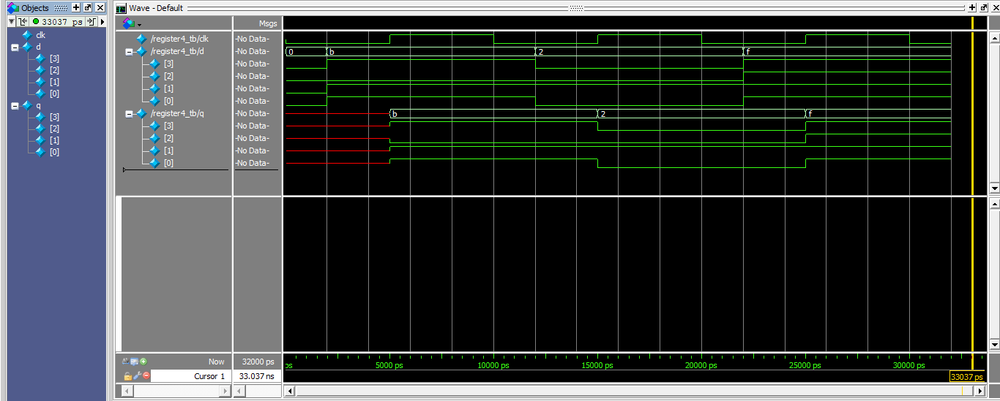

# 4-Bit Register in Verilog

A 4-bit D register: on every rising clock edge, `q` captures `d` and holds it until the next edge. Synthesizes to 4 D flip-flops.

## Design
```verilog
module register4 (
    input wire clk,
    input wire [3:0] d,
    output reg [3:0] q
);

    always @(posedge clk) begin
        q <= d;
    end

endmodule
```

## Simulation
The testbench drives `d` through 0x0 → 0xB → 0x2 → 0xF with a 10 ns clock. The waveform shows `q` updating only on rising clock edges: `q = B, 2, F`.



## How to run
- **Online:** paste `register4.v` and `register4_tb.v` into EDA Playground
- **Locally:** compile both files and run `register4_tb` in Questa/ModelSim, then `run -all`

## Related
- [4-bit ALU in Verilog]([link-to-alu-repo](https://github.com/monirulislam12k/4-bit-alu-verilog))
- Video walkthrough: [Instagram reel link]
